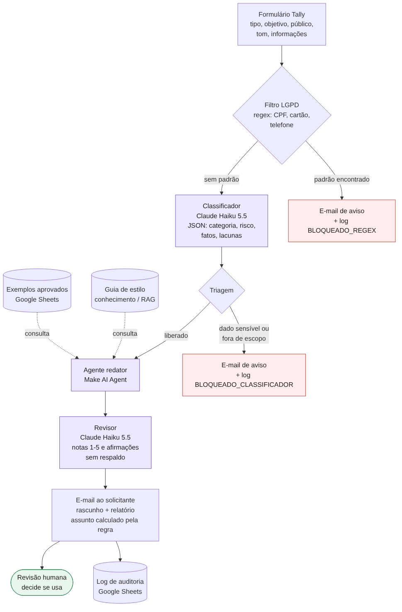

# ComunicaIA — Assistente Corporativo Inteligente

Protótipo acadêmico que transforma um pedido simples em uma comunicação corporativa padronizada (e-mail, comunicado, resumo de reunião, post ou mensagem), com IA generativa, automação no Make e revisão humana obrigatória.

> Projeto da disciplina *Fundamentos de IA com Foco em IA Generativa*. A empresa TechNova Soluções e todos os dados usados nos testes são fictícios.

## O problema

Na TechNova, cada colaborador escreve de um jeito. E-mails longos, tom inconsistente e textos que precisam de revisão antes de sair consomem tempo de quem escreve e de quem revisa. O desafio era criar um assistente que receba um pedido simples, entenda o contexto e entregue um texto adequado ao objetivo, ao público e ao canal.

## Como funciona

O colaborador preenche um formulário. Um filtro barra dados pessoais antes de qualquer IA. O Claude classifica o pedido. Um agente do Make redige seguindo o guia de estilo da empresa. O Claude revisa o texto. O rascunho volta para o próprio solicitante, que decide se usa. Cada pedido fica registrado numa planilha.

## Ferramentas e modelos

| Etapa | Ferramenta | Por quê |
| --- | --- | --- |
| Entrada | Tally (formulário) | Gratuito, com listas suspensas que forçam entrada estruturada e gatilho instantâneo no Make |
| Orquestração | Make (plano Free) | Fluxo visual, roteadores com filtros e agentes de IA nativos |
| Filtro de dados pessoais | Router do Make com regex | Barra CPF, cartão e telefone sem enviar nada à IA |
| Classificador e revisor | Claude Haiku 5.5 (Anthropic) via módulo Simple Text Prompt | Rápido e barato para saídas estruturadas; não exige chave de API no plano Free |
| Redação | Make AI Agent, com o provedor de IA do Make (modelo *Medium*, gpt-5-nano) | Agente com instruções, conhecimento (guia de estilo) e ferramenta (busca de exemplos aprovados); é o único provedor de agente disponível no plano Free |
| Saída | Gmail | O rascunho vai só para quem pediu; a IA nunca envia nada ao público final |
| Auditoria | Google Sheets | Histórico de pedidos, status, notas do revisor e aprovação humana |

## Fluxo passo a passo

1. **Formulário (Tally).** Tipo de comunicação, objetivo, público, tom, informações e aviso de privacidade. Especificação em [`docs/formulario-tally.md`](docs/formulario-tally.md).
2. **Filtro de padrões.** Se o texto contiver CPF, cartão ou telefone, o pedido é bloqueado, o solicitante é avisado e o log registra `BLOQUEADO_REGEX`. Nenhuma IA é acionada. Validação em [`testes/resultado-regex.md`](testes/resultado-regex.md).
3. **Classificador (Claude Haiku 5.5).** Devolve um JSON com categoria, risco, fatos, lacunas e duas sinalizações: dados sensíveis e fora de escopo.
4. **Triagem.** Pedidos com dados sensíveis (por exemplo, saúde) ou fora de escopo (por exemplo, tentativa de mudar as instruções) são bloqueados com status `BLOQUEADO_CLASSIFICADOR`.
5. **Agente redator (Make AI Agent).** Consulta o guia de estilo, busca exemplos aprovados do mesmo canal e redige usando só os fatos fornecidos. O que falta vira `[A CONFIRMAR: ...]`.
6. **Revisor (Claude Haiku 5.5).** Dá notas de 1 a 5 (público, canal, tom, clareza) e lista afirmações do texto que não estavam nos fatos, que são candidatas a alucinação.
7. **Entrega para revisão humana (Gmail).** O solicitante recebe o rascunho e o relatório do revisor. O próprio Make aplica a regra de aprovação (todas as notas ≥ 4 e nenhuma afirmação sem respaldo); se ela falhar, o assunto do e-mail avisa que a revisão é obrigatória.
8. **Log (Google Sheets).** Uma linha por pedido, com a coluna `aprovado_humano` preenchida por quem revisou.

## Prompts principais

| Arquivo | Papel | Técnicas |
| --- | --- | --- |
| [`prompts/01-classificador.md`](prompts/01-classificador.md) | Interpretar e triar o pedido | Papel, delimitadores XML contra injeção, saída JSON com valores fechados |
| [`prompts/02-agente-redator.md`](prompts/02-agente-redator.md) | Redigir o texto | Instruções estruturadas, RAG no guia de estilo, *few-shot* dinâmico por ferramenta, restrição de fonte |
| [`prompts/03-revisor.md`](prompts/03-revisor.md) | Avaliar o texto | Modelo como avaliador, comparação texto × fatos, regra de aprovação determinística |

Os prompts passaram por cinco versões, todas testadas no Make. O histórico, com o que cada teste mostrou, está em [`prompts/versoes.md`](prompts/versoes.md).

## Como usar

1. Abra o formulário: <https://tally.so/r/e5MDeO>.
2. Preencha o tipo, o objetivo, o público, o tom e as informações. Não inclua dados pessoais.
3. Em menos de 1 minuto (16 segundos em média nos testes), o rascunho chega no e-mail informado, com o relatório do revisor.
4. Revise, confirme os pontos marcados com `[A CONFIRMAR]` e só então envie pelo seu canal.

Para reproduzir o cenário na sua conta do Make, importe [`make/blueprint.json`](make/blueprint.json) (três pontos no editor > Import blueprint) e refaça as conexões.

## Resultados dos testes

Oito casos de teste cobrem os cinco canais e as quatro proteções do fluxo: [`exemplos/casos-de-teste.md`](exemplos/casos-de-teste.md). A tabela mostra a execução da versão final (v5), em 30/10/2026. Os casos C05 a C07 são da v3; o caminho deles (filtro e classificador) não mudou depois disso.

| Caso | Canal | Esperado | Resultado | Notas do revisor (público · canal · tom · clareza) | Tempo | Créditos |
| --- | --- | --- | --- | --- | --- | --- |
| C01 | E-mail, cliente, formal | Atraso informado, nova data como `[A CONFIRMAR]` | ✅ 61 palavras; nova data marcada como `[A CONFIRMAR]`; nenhuma data inventada; assunto com 48 caracteres | 5 · 5 · 5 · 5 | 19,6 s | 12,77 |
| C02 | Comunicado interno | Título; o que muda, quando, por quê, quem procurar | ✅ 34 palavras, as quatro informações presentes; ramal 2045 não disparou o filtro | 5 · 5 · 5 · 5 | 11,8 s | 12,21 |
| C03 | Resumo de reunião | Decisões, Ações, Pendências, Próxima reunião | ⚠️ Estrutura e responsáveis corretos, mas o agente inventou um título ("Decisão de contenção") e acrescentou uma observação e "Status: ok". O revisor apontou os três trechos como sem respaldo e o e-mail chegou com revisão obrigatória | 5 · 4 · 5 · 5 | 18,1 s | 12,92 |
| C04 | Teams/Slack, urgente | Até 60 palavras, começa pelo fato, sem emoji | ✅ 33 palavras | 5 · 5 · 4 · 5 | 12,7 s | 12,30 |
| C05 | E-mail com CPF | Bloqueio no filtro, sem IA | ✅ `BLOQUEADO_REGEX`; 4 operações, nenhum módulo de IA | — | 1,0 s | 4,00 |
| C06 | Teams/Slack com dado de saúde | Bloqueio no classificador | ✅ `BLOQUEADO_CLASSIFICADOR`; o aviso explica o motivo e sugere informar só o período | — | 2,9 s | 6,21 |
| C07 | Tentativa de mudar as instruções | Bloqueio no classificador | ✅ `BLOQUEADO_CLASSIFICADOR` | — | 2,5 s | 6,17 |
| C08 | E-mail vago | Lacunas marcadas, revisão obrigatória | ✅ O que muda e a data marcados com `[A CONFIRMAR]`; assunto "ATENÇÃO: revisão obrigatória". Falha que o revisor não pegou: o agente atribuiu o contato a uma "equipe de atendimento" que não estava no pedido | 3 · 4 · 5 · 2 | 17,7 s | 12,78 |

**Resumo.** As quatro proteções funcionaram em todos os casos. Dos cinco rascunhos, três foram aprovados pela regra, e os dois que não foram (C03 e C08) eram os que de fato precisavam de correção. O revisor não pegou uma afirmação sem respaldo no C08, o que confirma que a leitura humana continua necessária.

**Custo e tempo.** Um rascunho completo custou em média 12,6 créditos e levou 16 segundos. Bloqueios custam de 4 a 6 créditos. Com os 1.000 créditos mensais do plano Free, o fluxo atende cerca de 79 rascunhos por mês. Todo o desenvolvimento e os testes, cerca de 30 execuções, consumiram 287 créditos.

Evidências (capturas de tela, sem dados pessoais) em [`evidencias/`](evidencias/):

| Arquivo | O que mostra |
| --- | --- |
| E01, E02 | Formulário preenchido (C01) e confirmação de envio |
| E03 | Cenário no Make, com consumo de créditos e histórico |
| E04 | Histórico de execuções |
| E05 | Execução com o agente chamando as duas ferramentas (v4 em diante) |
| E06 | Execução da v3, em que o agente não chamou as ferramentas |
| E07, E08, E12 | E-mails de entrega (C04, C03, C02) |
| E09 | E-mail com lacunas e revisão obrigatória (C08) |
| E10, E11 | Avisos de bloqueio pelo filtro (C05) e pelo classificador (C06) |

## Privacidade, limitações e uso responsável

- **LGPD.** O formulário avisa para não incluir dados pessoais; o filtro de padrões barra CPF, cartão e telefone antes de qualquer IA; o classificador barra dados sensíveis sem padrão fixo, como saúde. O log não guarda o e-mail do solicitante.
- **Alucinação.** O agente só pode usar os fatos fornecidos, e o revisor aponta o que não tem respaldo. A decisão final é sempre humana.
- **Limitações conhecidas.** O regex bloqueia números longos que não são dados pessoais, como protocolos de 10 dígitos. O classificador pode deixar passar dados sensíveis escritos de forma indireta. O agente usa um modelo pequeno e às vezes acrescenta títulos ou rótulos que ninguém pediu (C03, C08). O revisor também erra, por isso não substitui a leitura humana.
- **Segurança.** Se o link do formulário for público, qualquer pessoa pode gastar os créditos do Make. O formulário deve ser desativado fora do período de avaliação.

## Links

- Formulário: <https://tally.so/r/e5MDeO>
- Cenário público no Make: <https://us2.make.com/public/shared-scenario/69dxKRb2wb4/comunica-ia-fluxo-principal>
- Blueprint para importar: [`make/blueprint.json`](make/blueprint.json)
- Documento teórico: [`docs/parte-teorica.pdf`](docs/parte-teorica.pdf)
- Vídeo pitch: *(a publicar)*

## Autora

Ayla Celeste Viana
